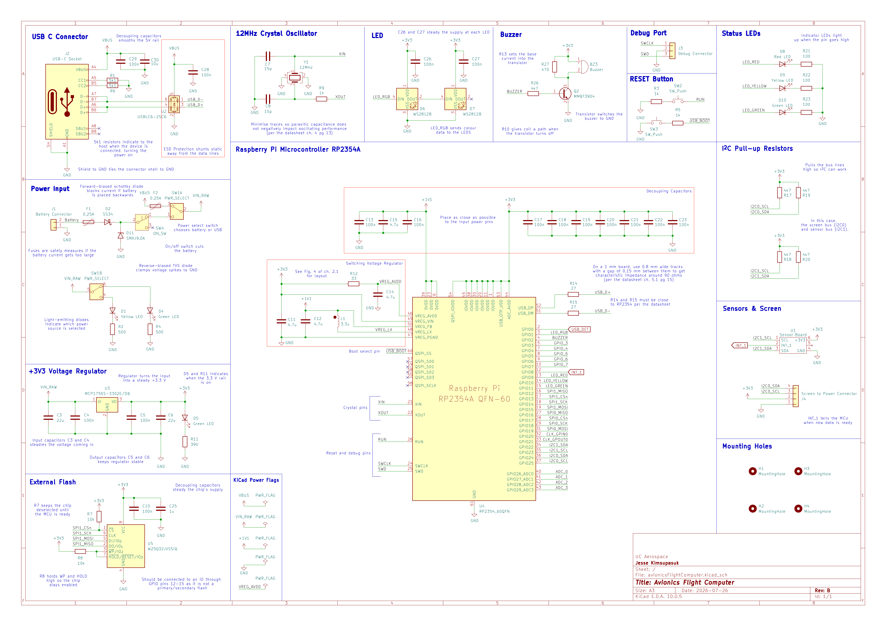
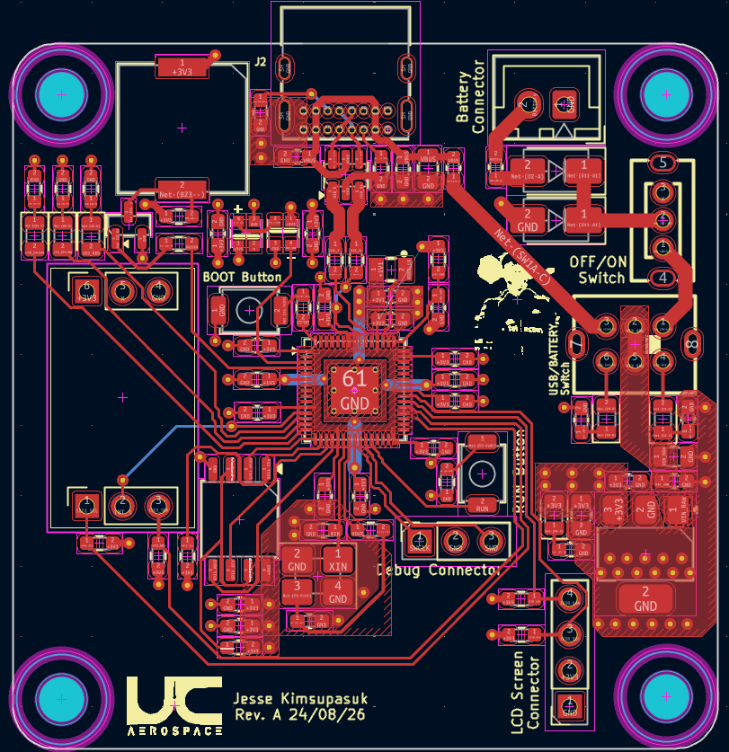
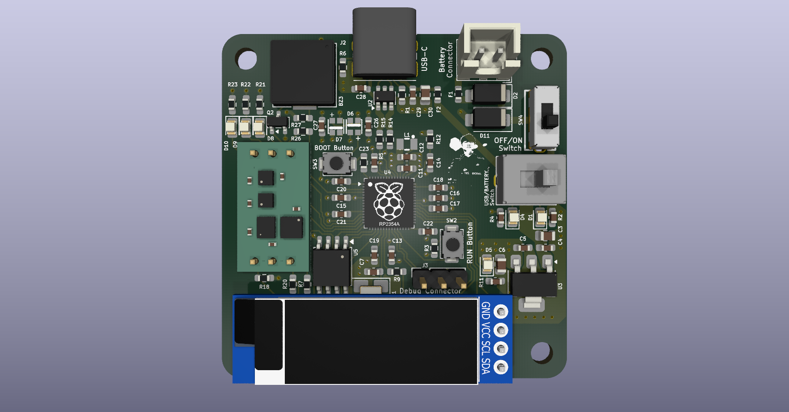
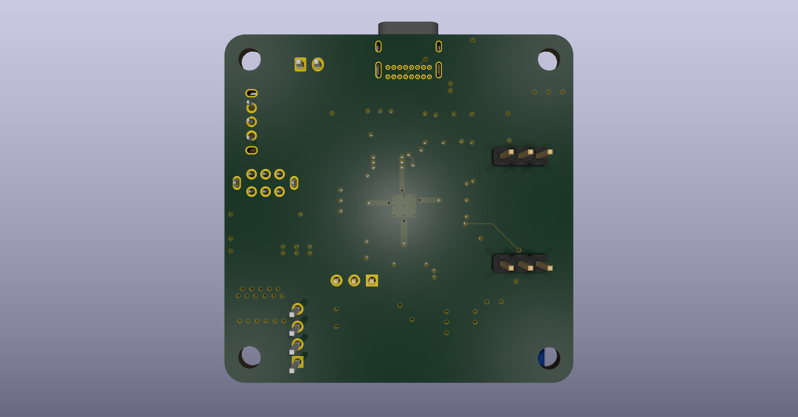

# Avionics Flight Computer

Using skills learned from my university courses, I have completed schematic capture in **KiCad** to design hardware that I can test in real-world applications, such as those found in UAVs and rocketry. This project involves end-to-end design tasks, including circuit design, verification, and troubleshooting. I am also applying justifiable design decisions through my choice of COTS components, such as the Raspberry Pi RP2354A.

Using tools such as oscilloscopes to verify and troubleshoot the board's circuitry before integrating onboard instrumentation, such as accelerometers and barometers, was an important aspect of this project. This was particularly important because the project only had one opportunity to launch each year, making it a small-scale introduction to the considerations involved in safety-critical systems found in commercial space launches. These onboard sensors will allow me to collect data during launch for post-flight analysis, while the RRC2+ altimeter system will independently monitor barometric pressure to detect apogee and trigger the drogue deployment system.

In the future, I am planning to use one of the boards as a test article, as I am quite curious about how the system will behave under certain external conditions. For example, heating the board up in an oven to simulate extreme temperatures and investigate how it performs in high-vibration environments by placing it in a metal box and driving around with it secured inside a car (are some ideas). Finding out where and how the board fails is something I am curious about, and I would love to tabulate my findings later this year.

For more context, the computer is intended to be fitted inside the payload tube of a high-power rocket and will therefore be designed to withstand high G-forces. Peak G-force is experienced during the launch off the rail, and during landing, so either could affect the accuracy of the instruments and the reliability of the electronics. Figure 1 shows the schematic of the flight computer through KiCad, and Figure 2-3 shows my board layout that is manufactured.

   
 
  <i>Figure 1: Schematic of Avionics Flight Computer</i>

   
 
  <i>Figure 2: PCB Layout of Avionics Flight Computer</i>

  
    
  <i>Figure 3: 3D PCB layout of Avionics Flight Computer </i>

