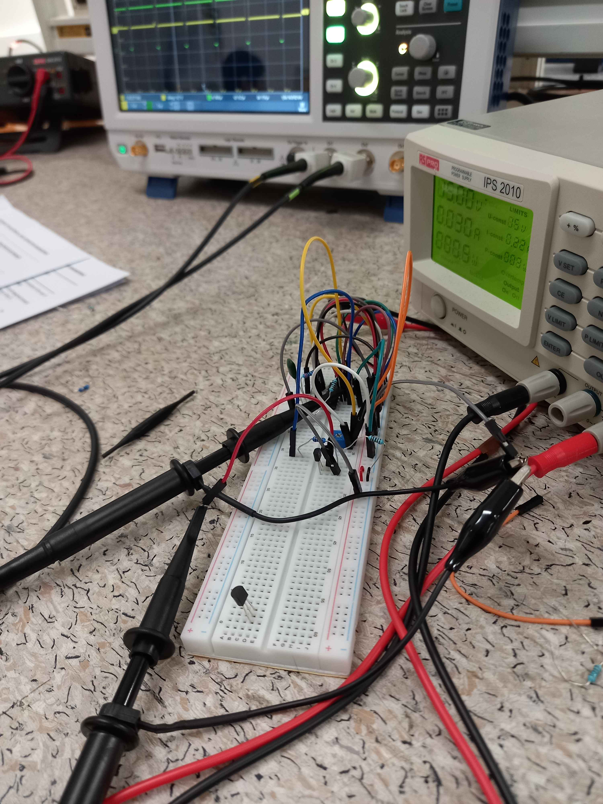
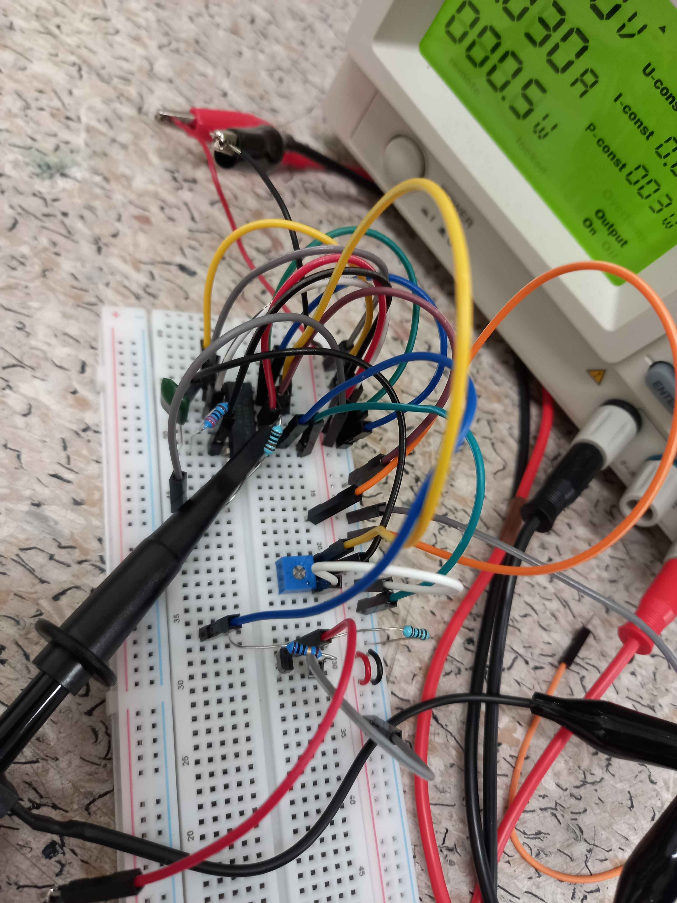

# Solar Car

Designed and implemented a high-efficiency, closed-loop buck converter to regulate solar panel output for a DC motor in a solar-powered car application. The objective was to maintain operation at the panel’s maximum power point (MPP) while delivering a stable voltage under variable load conditions. The project progressed from initial breadboard testing to veroboard and, finally, to a two-layer PCB designed using KiCad.

Before assembling the design, ensuring that the calculations aligned with the expected simulations in LTspice was an important learning point in this project. Verifying that waveforms matched the expected outputs (e.g. square waveforms) helped confirm that the PWM output was working as intended. This also allowed me to test the design in stages and identify whether the TL494 switching controller, CMOS gate driver, or power stage was failing.

Taking this project end-to-end, from open-loop breadboard testing to transferring the design onto a practical hardware application such as a solar car, took my troubleshooting and design skills to another level. My key learnings from this project are summarised below.

### Key Responsibilities
* **Designed** a DC-DC buck converter from first principles, including inductor sizing, air gap calculation, and capacitor selection
* **Developed** a closed-loop feedback control system using an integrator-based PWM controller
* **Implemented** a MOSFET-based gate driver to improve switching speed and reduce conduction losses
* **Designed and optimized** a custom PCB layout to minimize parasitic inductance, capacitance, and switching noise
* **Characterized** the solar panel to determine maximum power point across varying light conditions
* **Validated performance** through oscilloscope measurements and LTspice simulations

### Key Learnings

* **Developed** my understanding of troubleshooting through oscilloscopes and how specific design decisions can affect how the circuit is behaving
* **Applied power electronics theory** to a real-world renewable energy system
* **Gained practical experience** in magnetic component design (inductor windings, air gap sizing)
* **Strengthened** understanding of switching losses, control stability, and ripple minimisation
* **Developed** PCB layout strategies for high di/dt and dv/dt systems
* **Learned** the importance of iterative testing between simulation and hardware outcomes

In summary, a functional DC-DC buck converter was delivered, being capable of stable voltage regulation under varying solar input and load conditions. Achieved low output voltage ripple and fast switching response (36 ns switching time). Will compete in the Solar Car Competition @ UC on 22nd of Oct!

### Future Improvements

In regards to the project timeline, an asynchronous buck converter was designed for the sake of simplicity. This cut down the time to manufacture, test, and assemble the boards, but obviously leaves room for efficiency gains in the design. 

An avenue I would pursue if continuing the project would be to create a synchronous buck converter, which will need a bootstrap circuit to drive the high-side N-channel MOSFET. This would replace the BS250P PMOS, BS270 NMOS, and SB240S diode in the power stage to a synchronous driver (e.g. a IR21844), along with both IPP034N03L N-channel MOSFETs acting as the low-side and high-side instead. This would effectively allow another MOSFET to be placed in parallel to the free-wheel diode, which when on, would effectively bypass the diode and remove the associated losses in the circuit. 

Due to the limited resources found in the electrical store at the University, only through hole components could be used in the design. Replacing the capacitors and resistors with SMD components would reduce noise by having a smaller di/dt and dv/dt loops while also being able to further reduce the package size.

  
    
  <i>Figure 6: Breadboard circuit of a CMOS Gate Driver</i>

  
    
  <i>Figure 6: Breadboard circuit of a CMOS Gate Driver</i>

